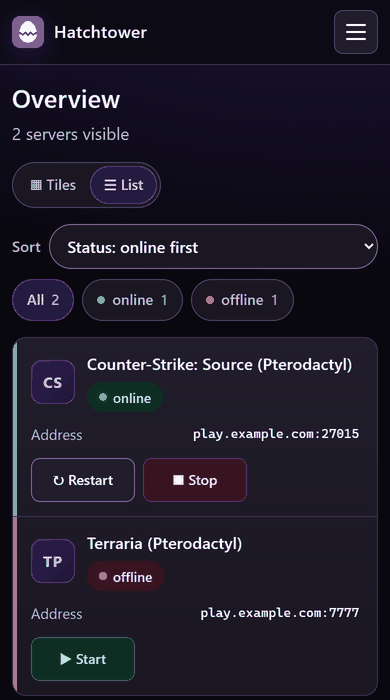

<div align="center">


# Hatchtower

[English](README.md) · **Deutsch**

**Gib Freunden eine einfache, sichere Seite für ihre Game-Server –
ohne dein Panel ins Internet zu stellen.**

Hatchtower legt sich über Pterodactyl, Pelican oder Calagopus. Deine Freunde sehen, ob ihr Server
läuft, starten ihn, starten ihn neu oder ändern eine Konfigurationsdatei. Dein Panel bleibt im Heimnetz.


<table>
  <tr>
    <td width="32%"></td>
    <td width="68%"><br>
      <sub>So sehen es deine Freunde: die <b>einfache Ansicht</b>. Status, Adresse, Passwort und große
      Knöpfe – sonst nichts. Du als Owner bekommst den Rest: Diagramme, Konsole, Dateien, Backups,
      Automationen, Rechte.</sub></td>
  </tr>
</table>

</div>

---

## Warum nicht einfach Subuser?

Wenn deine Freunde mit dem Panel klarkommen und es erreichen können, **reichen Subuser** – dann
brauchst du Hatchtower nicht. Gebaut wurde es für die Fälle, in denen das nicht klappt:

| | Panel mit Subusern | Hatchtower |
|---|---|---|
| **Panel bleibt privat** – von außen ist nur Hatchtower erreichbar | ✗ Freunde brauchen Zugriff aufs Panel | ✓ |
| **Läuft hinter Pangolin / einem Reverse-Proxy**, ohne Gefummel mit Websockets, Uploads und Wings-Ports | oft mühsam | ✓ eine normale HTTPS-App, Konsole und Dateien laufen über sie |
| **Einfache Ansicht** für Freunde, die nur spielen wollen | ✗ volle Panel-Oberfläche | ✓ |
| **Gruppen über viele Server** („Spieler“, „Moderator“, „alle Server, auch künftige“) | pro Server und Benutzer | ✓ |
| **Einladungslinks**, die man in Discord posten kann – ohne Mailserver, ohne Passwörter zu verschicken | ✗ | ✓ |
| **Discord**: Live-Serverstatus in deinen Kanälen, Meldungen bei Absturz und vollem Speicher | ✗ | ✓ |
| **Neustart nach Absturz**, auch wenn Wings aufgibt; geplante Neustarts mit Warnung im Spiel | teilweise | ✓ |
| **Panel wechseln** (Pterodactyl → Pelican oder Calagopus) und Benutzer, Rechte und Zeitpläne behalten | ✗ von vorn | ✓ |

**Wie es anfing:** Ich hoste Game-Server für meine Freunde zu Hause. Das Panel hinter Pangolin zu
stellen hat nie richtig geklappt – die Seite lud, aber Knöpfe taten nichts und Dateiübertragungen
brachen ab. Hatchtower spricht von innen mit dem Panel und ist das Einzige, was Freunde von außen
erreichen. Siehe [Reverse-Proxy und Pangolin](docs/reverse-proxy.de.md).

<sub>🤖 Hatchtower wurde zusammen mit <a href="https://claude.ai">Claude</a> (Anthropic) entwickelt –
ohne diese Unterstützung wäre das Projekt in dieser Form nicht möglich gewesen. Der Code ist offen
(AGPL-3.0), jede Route ist durch einen automatischen Rechte-Test abgedeckt (`tests/`, über 800 Tests),
und der Nur-Lesen-Modus wird im Code erzwungen, nicht nur in der Oberfläche.</sub>

---

## Was ist Hatchtower?

Hatchtower **ergänzt** dein Panel, es ersetzt es nicht. Die Server laufen weiter im Panel,
Hatchtower legt sich darüber und bringt:

- 🙂 eine **einfache Ansicht** für Freunde und **alles** für dich
- 👥 **eigene Benutzer** mit genau den Rechten, die du ihnen gibst – pro Server
- 📈 **Live-Monitoring** mit Verlauf von CPU, RAM und Netzwerk
- ⏰ **Automationen** wie Neustart bei Absturz oder nächtliche Neustarts
- 💾 **Backups** von ganzen Servern oder einzelnen Spielständen – auf ein Laufwerk, eine SMB-Freigabe oder direkt in den Browser
- 📜 ein **Audit-Log**, das festhält, wer wann was getan hat
- 🔒 einen **Nur-Lesen-Modus**, mit dem garantiert nichts am Panel verändert wird

### Unterstützte Panels

| Panel | Getestet mit | Anbindung |
|---|---|---|
| [Pterodactyl](https://pterodactyl.io) | Panel 1.15.1, Wings 1.13.3 | Application-Key (nur lesen) und Client-Key |
| [Pelican](https://pelican.dev) | Panel und Wings 1.0.0-rc.1 | Application-Key (nur lesen) und Client-Key |
| [Calagopus](https://calagopus.com) | Panel und Wings 1.2.5 (integrierte oder eigene Wings) | ein API-Key mit Admin-Lese- und Server-Rechten |

Eine Installation verwaltet **ein** Panel. Welches, wählst du bei der Einrichtung; wechseln
kannst du später unter **System → Panel**.

> **In 5 Minuten startklar:** Ein Befehl installiert alles, danach führt dich ein Assistent im
> Browser durch die Einrichtung.

---

## Ein Blick hinein

### Alle Server auf einen Blick

Liste oder Kacheln, Filter nach Status und eigenen Tags, Favoriten oben. Mehrere Server
gleichzeitig starten, stoppen oder neu starten.


### Jeder Server im Detail

Status, Adresse, Online-Zeit der letzten 30 Tage, Verlauf bis 72 Stunden und die
**Live-Konsole** mit Suche und Download – in Reitern, damit nichts am Ende einer langen Seite verschwindet.


### Dateien direkt im Browser

Ansehen, hochladen, herunterladen (auch als ZIP), umbenennen, löschen und bearbeiten.
Beim Speichern bleibt die alte Fassung als `.bak` liegen und ist mit einem Klick zurück.

<table>
  <tr>
    <td width="50%"></td>
    <td width="50%"></td>
  </tr>
</table>

### Benutzer und Rechte – so fein, wie du willst

Gruppen wie „Moderator“ oder „Spieler“ anlegen und pro Server zuweisen. Wer nur sehen soll,
ob der Server läuft, sieht nur das. Neue Leute kommen per **Einladungslink** dazu, ohne dass
du Passwörter verschicken musst.

<table>
  <tr>
    <td width="50%"></td>
    <td width="50%"></td>
  </tr>
</table>

### Automationen

Neustart nach Absturz und Zeitpläne (wöchentlich oder einmalig) zum Starten, Stoppen und
Neustarten – mit Vorwarnung im Spiel, z. B. „Neustart in 15 Minuten!“.


### Backups

Ganze Server oder nur die Spielstände sichern – Dateien einfach im Datei-Explorer ankreuzen.
Ziel: Laufwerk, SMB-Freigabe oder Download im Browser. Auf Wunsch wird der Server vorher
gestoppt und danach wieder gestartet.

### Audit-Log

Jede Aktion wird festgehalten und lässt sich nicht nachträglich ändern. Filter nach Aktion,
Benutzer und Server, Export als CSV oder TXT.


### Öffentliche Statusseite, Handy und Login

Eine Statusseite für deine Spieler (abschaltbar, nur Anzeige). Auf dem Handy passt sich
Hatchtower automatisch an.

<table>
  <tr>
    <td width="62%"><br><br>
                    </td>
    <td width="38%"></td>
  </tr>
</table>

<sub>Alle Screenshots stammen aus einer Demo-Instanz mit erfundenen Servern und Benutzern.</sub>

---

## Alle Funktionen

<details>
<summary><b>Komplette Liste aufklappen</b></summary>

**Server**
- Einfache Ansicht (Status, Adresse, Passwort, Start/Stopp) oder alles – pro Benutzer, Standard pro Instanz, vom Owner festlegbar
- Übersicht als Liste oder Kacheln, Statusfilter, Sortierung, Live-Werte (CPU bezogen aufs Limit, RAM, Speicher)
- Start, Stop, Restart, Kill (nur Owner), Konsolenbefehle
- Mehrere Server auf einmal starten, stoppen oder neu starten
- Live-Konsole und Verlauf von CPU, RAM und Netzwerk (live bis 72 Stunden)
- Favoriten und eigene Tags
- Verfügbarkeit: Online-Zeit und Abstürze der letzten 30 Tage
- Log-Archiv: Konsole laufender Server wird mitgeschrieben (1–90 Tage oder aus), durchsuchbar, Fehler farbig, Download als .txt (eigenes Recht „Konsolen-Archiv sehen“)

**Dateien**
- Ansehen, herunterladen (auch mehrere als ZIP), hochladen, bearbeiten, umbenennen, löschen
- Automatische `.bak`-Sicherung beim Bearbeiten, Wiederherstellen mit einem Klick

**Benutzer und Sicherheit**
- Eigene Benutzer und Rechte pro Server, selbst erstellte Rechtegruppen
- Einladungslinks statt Startpasswort: 1–90 Tage oder unbegrenzt gültig, einmal bis unbegrenzt nutzbar, mit interner Beschreibung; Nutzung und Ablauf stehen im Audit-Log
- Optional E-Mail: eigene Adresse pro Benutzer mit Bestätigung, „Passwort vergessen“, Einladungen per Mail
- Audit-Log, das sich nicht verändern lässt
- Read-Only-Modus: Hatchtower kann komplett nur lesend betrieben werden

**Automationen und Benachrichtigungen**
- Neustart bei Absturz
- Wöchentliche und einmalige Zeitpläne mit Vorwarnung
- Benachrichtigungen per Discord/Webhook und E-Mail: Absturz, Neustart, Neustart fehlgeschlagen,
  Speicher fast voll, RAM dauerhaft hoch, Zeitplan fehlgeschlagen

**Backups**
- Backup-Jobs für einen, mehrere oder alle Server (auch künftige), ganze Server oder ausgewählte Dateien und Ordner, mit Ausschlüssen (z. B. `logs/`, `*.log`)
- Dateien und Ordner direkt im Datei-Explorer zu einem Backup-Job hinzufügen
- Ziele: Laufwerk im Hatchtower-Container (z. B. Proxmox-Mountpoint, USB, NFS), SMB-Freigabe (Windows, NAS, Samba) oder Direktdownload im Browser
- Von Hand oder per Zeitplan, mit Fortschrittsanzeige; laufende Backups lassen sich abbrechen
- Server vorher stoppen (mit Vorwarnung im Spiel) und danach wieder starten
- Aufbewahrung nach Anzahl oder Tagen, Platzprüfung vorab, Meldung per Webhook/E-Mail
- Eigene Rechte: Backups sehen, starten und herunterladen, Backup-Jobs verwalten
- Schont das Anfragen-Limit des Panels, damit Statusabfragen nicht ausfallen

**Community**
- Öffentliche Statusseite (abschaltbar): Name, Spiel, Status und Adresse ausgewählter Server
- Server-Status in Discord, auch in mehreren Kanälen – jeder mit eigener Server-Auswahl und Überschrift
- Ankündigungen oben auf jeder Seite, mit geplantem Beginn und Ende

**Aussehen und Sprache**
- 3 Themes (Dunkel, Mittel, Hell), pro Benutzer gespeichert
- Eigener Name und eigene Logos (z. B. die deiner Community)
- Deutsch und Englisch, automatisch nach Browsersprache oder per Umschalter
- Optimiert für Handy und Tablet

**Datenschutz und Umzug**
- Einstellbare Aufbewahrung (Audit-Log Standard 30 Tage)
- Impressum und Datenschutzerklärung mit Vorlagen, Datenauskunft pro Benutzer
- Datenumzug: alle Benutzer, Rechte, Logos und Einstellungen verschlüsselt exportieren und in einer neuen Instanz einspielen

</details>

---

## Was du brauchst

| | |
|---|---|
| **System** | Debian 12 oder 13 (getestet, gerne als Proxmox-LXC); Ubuntu sollte auch gehen – **oder Docker** mit Compose |
| **Leistung** | 1 CPU-Kern, 512 MB RAM, 2 GB Speicher |
| **Netzwerk** | Zugriff auf das Panel **und** die Wings (meist Port `8080` und `2022`; bei Calagopus mit Wings-Proxy reicht das Panel) |
| **Panel** | Admin-Zugang, um die API-Keys anzulegen (siehe [Unterstützte Panels](#unterstützte-panels)) |

---

## Installation

Wähle **einen** der vier Wege. Alle Befehle als **root** (🅳: ein Benutzer, der Docker nutzen darf).

> 🔒 **Solange das Repository privat ist**, funktionieren die Befehle von 🅰 und 🅱 nicht direkt.
> Nimm dann die Variante [mit Zugangs-Token](#installation-mit-zugangs-token) weiter unten.

### 🅰 Proxmox VE: neuer Container mit einem Befehl

In der Shell des **Proxmox-Hosts** (nicht in einem Container):

```bash
bash -c "$(curl -fsSL https://raw.githubusercontent.com/skaot1910/hatchtower/main/proxmox/install.sh)"
```

Das Skript fragt Container-ID, Netzwerk, Port usw. ab (**Enter** übernimmt den Vorschlag),
legt einen Debian-Container an und installiert Hatchtower darin.

<details>
<summary>Ohne Rückfragen installieren</summary>

```bash
HT_YES=1 HT_CTID=120 HT_IP=192.168.1.50/24 HT_GW=192.168.1.1 bash -c "$(curl -fsSL https://raw.githubusercontent.com/skaot1910/hatchtower/main/proxmox/install.sh)"
```

Alle Variablen stehen oben in `proxmox/install.sh`.
</details>

### 🅱 Vorhandener Server oder Container

In der Shell des Servers, auf dem Hatchtower laufen soll:

```bash
bash -c "$(curl -fsSL https://raw.githubusercontent.com/skaot1910/hatchtower/main/installer/get.sh)"
```

### 🅲 Aus einem Paket (ohne Internetzugriff auf GitHub)

`hatchtower-<version>.tar.gz` unter **Releases** herunterladen, auf den Server kopieren, dann:

```bash
tar -xzf hatchtower-<version>.tar.gz
cd hatchtower-<version>
bash installer/install.sh
```

<details>
<summary>Optionen für 🅱 und 🅲</summary>

| Option | Bedeutung |
|---|---|
| `--port 8000` | Port der Oberfläche |
| `--bind 0.0.0.0` | Adresse, auf der Hatchtower lauscht |
| `--allow "192.168.1.5,192.168.1.10"` | Port nur für diese IPs öffnen (eigene nftables-Tabelle, deine Firewall bleibt unberührt) |

Bei 🅱 so anhängen: `bash -c "$(curl …)" _ --allow "192.168.1.5"`
</details>

### 🅳 Docker Compose

Im Ordner mit dem Quellcode (Git-Checkout oder entpacktes Release-Paket):

```bash
docker compose up -d --build
```

```bash
docker compose logs hatchtower
```

Im Log steht der **Einrichtungscode**. Danach `http://<server>:8000/setup` öffnen.

- Daten (Datenbank, Logos, Schlüssel) liegen im Volume `hatchtower-data`. **Sichere das ganze Volume** –
  die Datei `keys.env` darin braucht man, um die gespeicherten API-Keys zu entschlüsseln.
- Hinter einem Reverse-Proxy auf demselben Rechner den Port nur lokal freigeben: `"127.0.0.1:8000:8000"`.
  Unter **System → Netzwerk** die Proxy-IP eintragen; bei Docker meist das Bridge-Gateway
  (z. B. `172.17.0.1`) oder das Netz `172.16.0.0/12`.
- Backup-Ziele: einen Ordner unter `/mnt/…` in den Container einhängen (siehe Kommentar in `compose.yaml`).
- Befehle: `docker compose exec hatchtower hatchtower reset-password` (auch `selftest`, `version`, …).
- **Update:** neue Version holen, dann `docker compose up -d --build`. Den Update-Knopf in der
  Oberfläche gibt es nur bei der klassischen Installation.

### Installation mit Zugangs-Token

Solange das Repository privat ist, brauchst du einen **Lese-Token** vom Projekt. Die Befehle hier
**ersetzen** den Befehl aus 🅰 bzw. 🅱. Zuerst den Token eingeben (wird nicht angezeigt):

```bash
read -rsp "GitHub-Token: " GITHUB_TOKEN && export GITHUB_TOKEN HATCHTOWER_SAVE_TOKEN=1 && echo
```

Dann **für 🅰** (Shell des Proxmox-Hosts):

```bash
bash -c "$(curl -fsSL -H "Authorization: Bearer $GITHUB_TOKEN" -H "Accept: application/vnd.github.raw" https://api.github.com/repos/skaot1910/hatchtower/contents/proxmox/install.sh)"
```

**oder für 🅱** (Shell des Servers):

```bash
bash -c "$(curl -fsSL -H "Authorization: Bearer $GITHUB_TOKEN" -H "Accept: application/vnd.github.raw" https://api.github.com/repos/skaot1910/hatchtower/contents/installer/get.sh)"
```

Damit spätere Updates klappen, wird der Token auf dem Hatchtower-Server gespeichert (bei 🅰 fragt
das Skript vorher, **Enter** = ja). Bei 🅲 oder wenn er abgelaufen ist: `hatchtower github-token`.

<details>
<summary>Token erstellen (für den Inhaber des Repositorys)</summary>

GitHub → **Settings → Developer settings → Personal access tokens → Fine-grained tokens →
Generate new token**. Repository nur `hatchtower`, bei **Contents** „Read-only“, Ablaufdatum setzen.
</details>

---

## Einrichtung im Browser

Am Ende der Installation siehst du die **Adresse** und einen **Einrichtungscode**. Öffne die
Adresse im Browser – ein Assistent führt dich durch fünf Schritte:

1. **Owner-Konto** anlegen (mit dem Einrichtungscode)
2. **Panel** wählen (Pterodactyl, Pelican oder Calagopus), **Adresse** und **API-Key** eintragen –
   der Assistent zeigt für jedes Panel, wo es den Key gibt und welche Rechte er braucht
3. **Client-API-Key** eines eigenen Panel-Benutzers eintragen (mit *Allowed IP*; entfällt bei Calagopus)
4. **Wings-Server** prüfen – werden automatisch aus dem Panel gelesen, mehrere sind kein Problem
5. **Optionen** wählen: Modus, öffentliche Adresse für Spieler, Reverse-Proxy, Zeitzone

Fertig! 🎉

> 💡 Neue Installationen starten sicherheitshalber im Modus **Nur lesen**. Umstellen kannst du das
> jederzeit unter **System → Panel → Modus**.
>
> API-Keys werden verschlüsselt gespeichert und nie wieder angezeigt.

**Eigener Look:** Unter **Auftritt → Erscheinungsbild** hinterlegst du den Namen und die Logos
deiner Community. Theme und Sprache wählt jeder Benutzer selbst oben rechts.

---

## Update

```bash
hatchtower update
```

(Docker: nach dem Holen der neuen Version `docker compose up -d --build`.)

Das war's. Hatchtower lädt die neueste Version, prüft die Prüfsumme, **sichert vorher die
Datenbank** und kehrt automatisch zur alten Version zurück, falls die neue nicht startet.
Benutzer, Rechte, Logos, Zeitpläne und Verlauf bleiben erhalten.

Unter **System** zeigt Hatchtower an, wenn eine neue Version bereitsteht. Installiert wird nie
automatisch – nur, wenn du es willst.

---

## Befehle auf dem Server

| Befehl | Was er tut |
|---|---|
| `hatchtower update` | Neueste Version installieren |
| `hatchtower update --check` | Nur nachsehen, ob es ein Update gibt |
| `hatchtower update <paket>` | Ein vorhandenes Paket installieren |
| `hatchtower selftest` | Verbindung zu Panel und Wings prüfen (nur lesend) |
| `hatchtower version` | Installierte Version anzeigen |
| `hatchtower reset-password` | Passwort eines Benutzers neu setzen und Konto entsperren |
| `hatchtower create-owner` | Owner-Konto auf der Konsole anlegen |
| `hatchtower setup-token` | Neuen Einrichtungscode erzeugen (nur solange noch kein Konto existiert) |
| `hatchtower github-token` | Lese-Token für Updates hinterlegen, solange das Repository privat ist (`--remove` entfernt ihn) |
| `journalctl -u hatchtower -f` | Log des Dienstes live ansehen |

<details>
<summary>Wo liegt was?</summary>

| Pfad | Inhalt |
|---|---|
| `/opt/hatchtower` | Programm, Python-Umgebung, Installer, Lizenztext (`LICENSE`) |
| `/etc/hatchtower/hatchtower.env` | interne Schlüssel und Port (nicht weitergeben!) |
| `/var/lib/hatchtower/hatchtower.db` | Datenbank (SQLite) inkl. verschlüsselter API-Keys |
| `/var/backups/hatchtower/` | tägliches Backup um 03:30 (14 Tage) und Backups vor Updates |
| `/etc/hatchtower/github-token` | optional: Lese-Token für Updates, solange das Repository privat ist |

</details>

---

## Sicherheit

- 🔑 Starke Passwörter (Argon2id), Sperre nach Fehlversuchen, Sitzungs-Timeouts
- 🛡️ CSRF-Schutz, strenge Content-Security-Policy, kein Einbetten in fremde Seiten
- 🚫 „Alles verboten, was nicht erlaubt ist“ – Rechte pro Benutzer und Server
- 👀 Der Nur-Lesen-Modus ist technisch erzwungen: Schreibende Anfragen erreichen das Panel gar nicht erst
- 🌐 Für den Zugriff von außen bitte einen Reverse-Proxy mit HTTPS nutzen (z. B. Pangolin, Nginx, Traefik) – siehe [Reverse-Proxy und Pangolin](docs/reverse-proxy.de.md)

> ⚠️ Der Client-Key eines Panel-**Admins** darf technisch alles. Schütze ihn mit *Allowed IP*,
> Nur-Lesen-Modus und Audit-Log. Noch vorsichtiger: Lege einen eigenen Panel-Benutzer an und füge
> ihn nur als Subuser zu den gewünschten Servern hinzu.

<details>
<summary><b>Auf einem öffentlichen Server (VPS, Root-Server) betreiben</b></summary>

Hatchtower läuft auch auf einem Server im Internet. Damit es dort sicher ist:

1. **Nur auf localhost lauschen**, wenn der Reverse-Proxy auf demselben Server läuft:
   `sudo bash installer/install.sh --bind 127.0.0.1`. Sonst Port 8000 per Firewall
   (oder `--allow`) nur für den Proxy öffnen. Der Proxy darf sich nicht umgehen lassen.
2. **HTTPS über einen Reverse-Proxy.** Hatchtower selbst spricht nur HTTP. Beispiel mit Caddy
   (holt das Zertifikat automatisch):

   ```
   hatchtower.example.de {
     reverse_proxy 127.0.0.1:8000
   }
   ```

3. **Einrichtung sofort abschließen.** Solange kein Konto existiert, kann jeder mit dem
   Einrichtungscode den Owner anlegen. Den Code also nicht weitergeben und gleich nach der
   Installation einrichten.
4. **Proxy-IP eintragen** unter **System → Netzwerk → Reverse-Proxy-IPs** (bei Caddy auf
   demselben Server: `127.0.0.1`). Das ist im Internet Pflicht, nicht optional: Erst dann
   - erkennt Hatchtower HTTPS und setzt die Cookies mit `Secure` sowie HSTS,
   - sieht es die echten IPs der Besucher. Ohne Eintrag kommen alle von der Proxy-IP, und ein
     Angreifer mit zehn falschen Anmeldungen sperrt damit alle Besucher aus.

   Erlaubt sind IP-Adressen und Netze (z. B. `172.16.0.0/12` für Docker). `X-Forwarded-For` wird nur von diesen
   Adressen angenommen, gefälschte Angaben anderer Clients zählen nicht.
5. **Verbindung zum Panel und zu Wings:** Hatchtower muss das Panel und die Wings (meist Port
   `8080`) erreichen. Liegen sie nicht im selben Rechenzentrum, verbinde die Server lieber über
   einen VPN-Tunnel (z. B. WireGuard), statt den Wings-Port offen ins Internet zu stellen.
   Im Panel beim Client-Key *Allowed IP* auf die Adresse von Hatchtower setzen.

</details>

---

## Für Entwickler

<details>
<summary>Werkzeuge und Aufbau</summary>

| Werkzeug | Zweck |
|---|---|
| `bash tools/release.sh` | Neue Version veröffentlichen: Tag, Paket aus Git, Prüfsumme, GitHub-Release (Text aus `CHANGELOG.md`) |
| `tools/third_party_licenses.py` | Erzeugt bei der Installation `THIRD_PARTY_LICENSES.txt` |
| `tests/` | Tests mit pytest, u. a. die Rechte-Matrix aller Routen (`tests/routes.py` → `docs/rechte-matrix.md`) |

**Aufbau** (`app/hatchtower/`): `main.py` (Web), `panels.py` (unterstützte Panels),
`ptero.py` (Adapter für Pterodactyl und Pelican mit Read-Only-Sperre), `calagopus.py` (Adapter für Calagopus), `wings.py` (Konsole), `monitor.py` (Abgleich, Verlauf), `automation.py`,
`permissions.py`, `security.py`, `setup.py` (Einrichtung), `themes.py`, `db.py` (Migrationen).

**Übersetzungen** liegen in `app/hatchtower/locales/<sprache>.json` (deutscher Text → Übersetzung).
Fehlt eine Übersetzung, erscheint der deutsche Text.

</details>

---

## Lizenz

Hatchtower ist freie Software unter der **GNU Affero General Public License v3.0** (AGPL-3.0),
siehe [`LICENSE`](LICENSE). Copyright © 2026 skaot1910.

Kurz: nutzen, verändern und weitergeben ist erlaubt, auch kommerziell. Veränderte Fassungen
müssen wieder unter der AGPL-3.0 stehen – auch wenn du sie nur über das Netz anbietest.
Ohne Gewährleistung.

Alle Abhängigkeiten stehen unter freien Lizenzen (MIT, BSD, Apache-2.0, PSF, MPL-2.0). Die Liste
steht in der Oberfläche unter **Lizenzen** (Fußzeile), die vollständigen Texte in
`THIRD_PARTY_LICENSES.txt` auf dem Server.

<div align="center">
<sub>Hatchtower ist ein unabhängiges Projekt und steht in keiner Verbindung zu den Projekten Pterodactyl, Pelican oder Calagopus.</sub>
</div>
