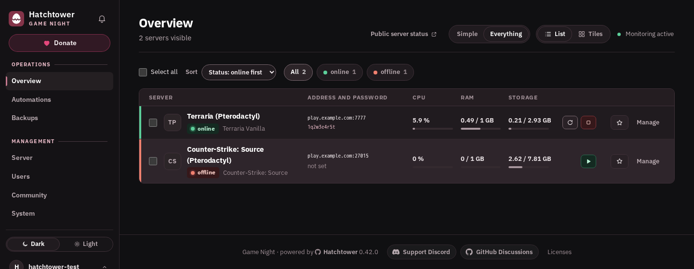
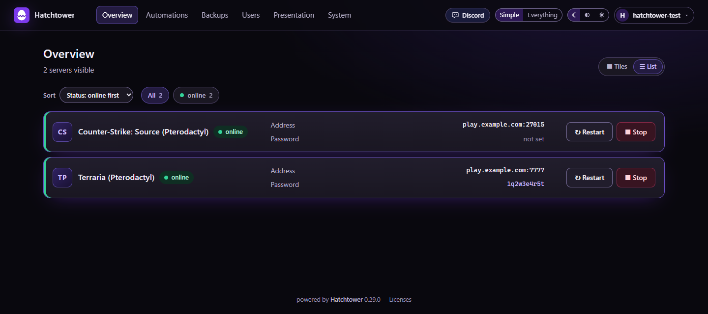
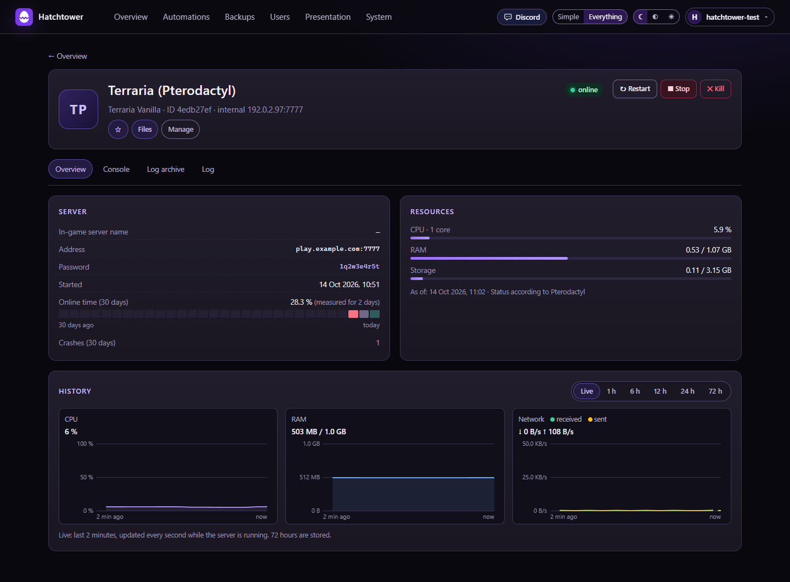
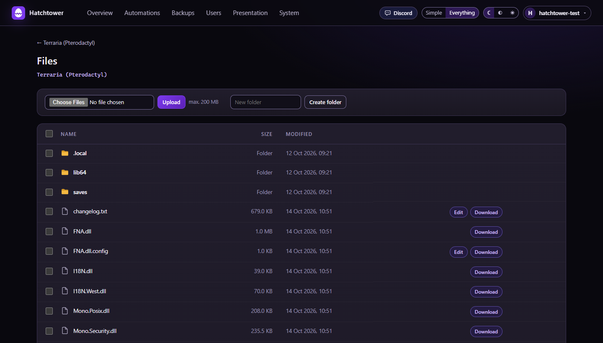
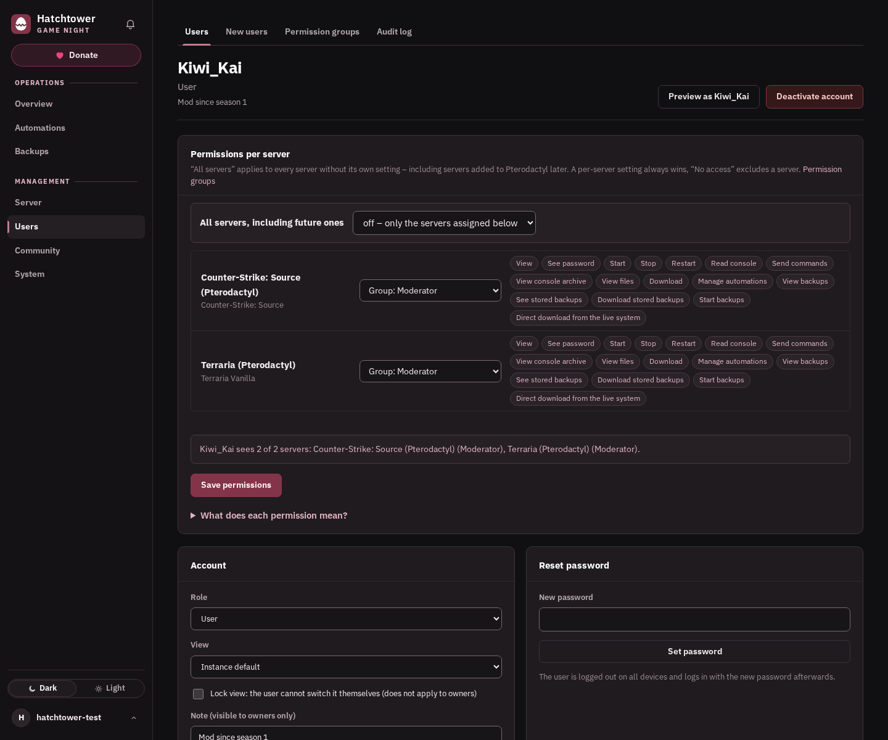
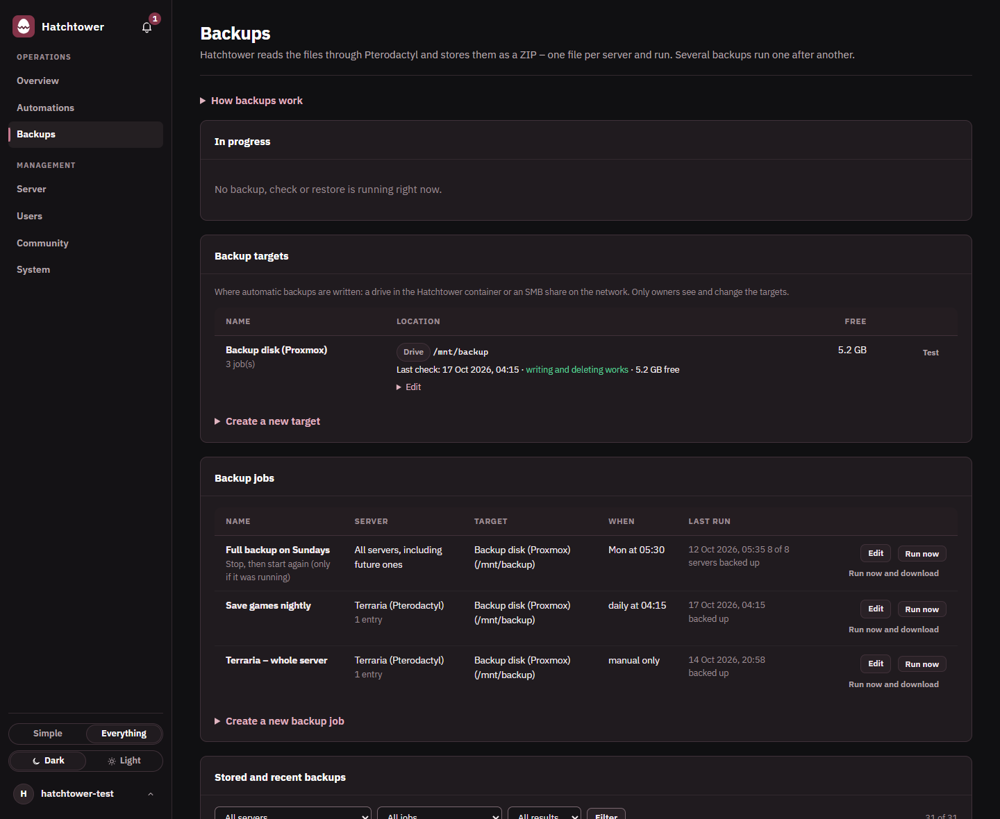
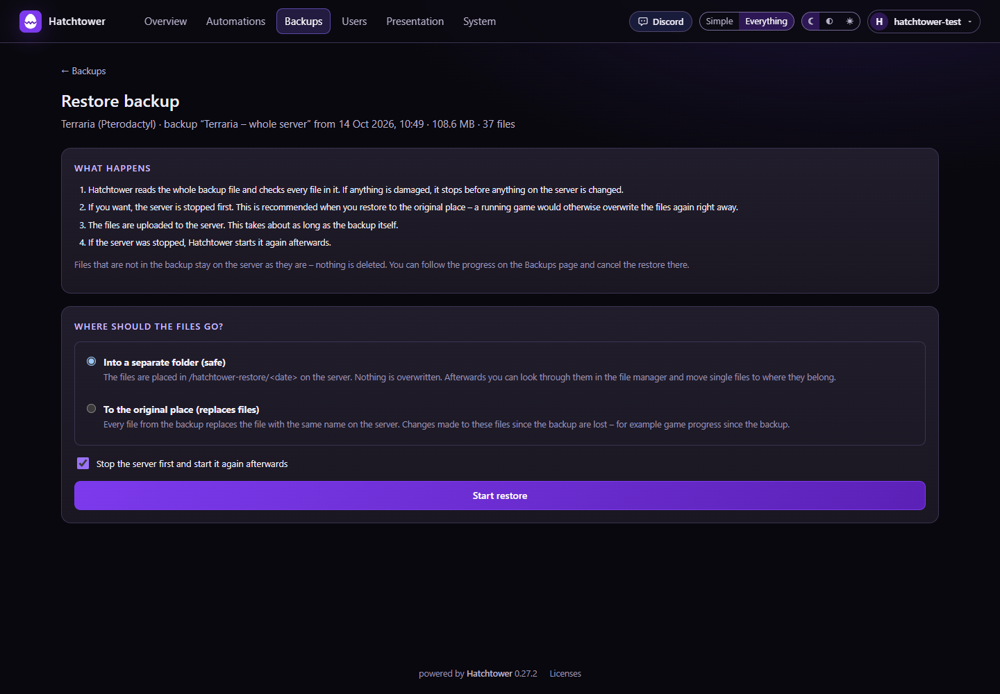
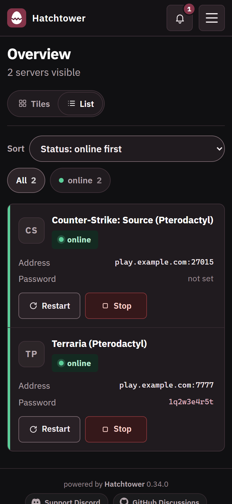
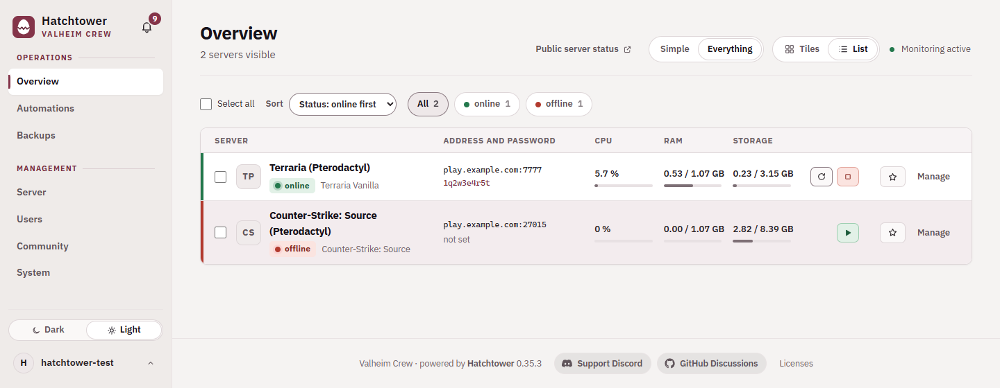
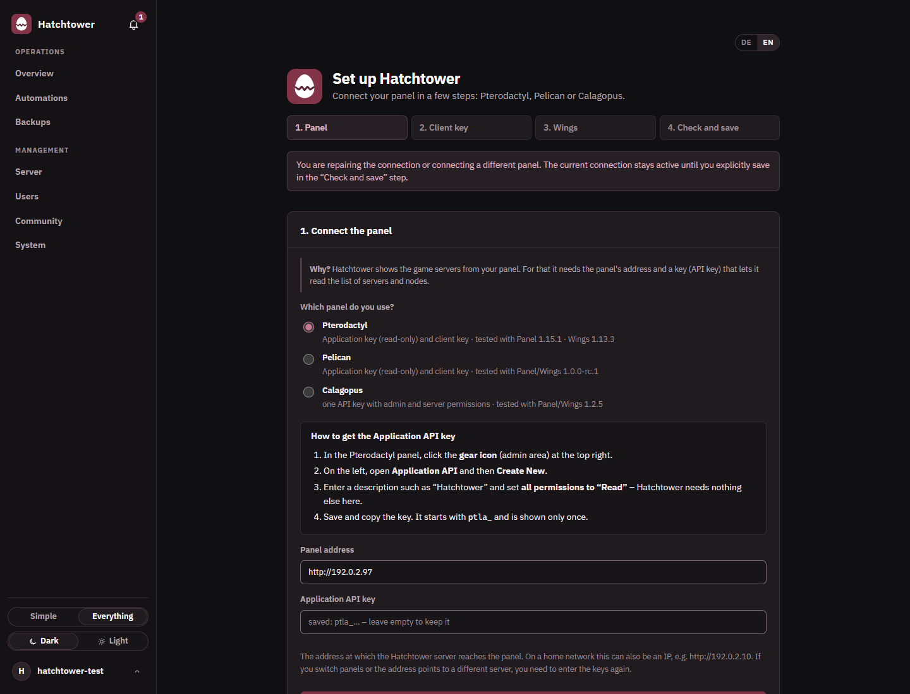

<div align="center">


# Hatchtower

**English** · [Deutsch](README.de.md)

**A simple, safe web page for your game servers – for you and your friends,
without putting your server panel on the internet.**

**Status: beta** – it works, but it is young and still changes quickly.




</div>

---

## Contents

1. [What is Hatchtower?](#1-what-is-hatchtower)
2. [Features](#2-features)
3. [Screenshots](#3-screenshots)
4. [Requirements](#4-requirements)
5. [Installation](#5-installation)
6. [First-time setup](#6-first-time-setup)
7. [API keys](#7-api-keys)
8. [Users and permissions](#8-users-and-permissions)
9. [Backups](#9-backups)
10. [Updating](#10-updating)
11. [Troubleshooting](#11-troubleshooting)
12. [Security](#12-security)
13. [FAQ](#13-faq)
14. [License](#14-license)

---

## 1. What is Hatchtower?

Game server panels like [Pterodactyl](https://pterodactyl.io), [Pelican](https://pelican.dev) and
[Calagopus](https://calagopus.com) are made for admins. Giving friends access shows them too much and means
putting the panel on the internet.

**Hatchtower is a small website next to your panel.** It talks to the panel inside your network and shows
each person only what you allow: your friends get a simple page with status, address, password and a
restart button – you get console, files, backups, schedules and permissions. Your panel stays as it is.

**Why it exists:** I wanted my friends to manage our game servers from outside, so I made the Pterodactyl
panel reachable from the internet. The page loaded, but buttons did not react reliably and the console and
file transfers kept failing – despite reverse proxy and WebSocket tweaks. On top of that, the full panel
simply shows friends far too much. So instead of exposing the panel, Hatchtower became a small, safe front
door that keeps the panel inside the home network.

> One Hatchtower installation connects to **one** panel (with any number of Wings nodes).

## 2. Features

- **Simple view** for friends: status, address, join password, start/restart – also on phones
- **Overview** with live CPU, RAM and disk, favourites and tags; server page with history, uptime and **live console**
- **File manager**: view, upload, download (also as ZIP), edit, rename, delete
- **Permissions per user and server**, reusable permission groups and **invite links**
- **Automations**: restart after a crash, scheduled starts/stops/restarts with in-game warning
- **Backups** to a drive or SMB share, checked after writing and **restorable** in a few clicks
- **Notifications** via Discord/webhook and email, **audit log**, optional **public status page**
- **Read-only mode**, own name and logo, dark/medium/light theme, English and German

## 3. Screenshots

All screenshots use a test panel with made-up servers and users.

**The simple view – what your friends see**



**Server details** – status, resources, history; console and logs in the tabs.



**Files**



**Permissions per user and server**



**Backups**



<table>
  <tr>
    <td width="62%"><br>
      <sub>Restoring a backup.</sub></td>
    <td width="38%"><br>
      <sub>On a phone.</sub></td>
  </tr>
</table>

**Light theme** (switch with ☾ ◐ ☀ at the top right)



## 4. Requirements

- **A panel** (Pterodactyl, Pelican or Calagopus) with an admin account to create the API keys
- **A small Linux machine**: Debian 12/13 (Ubuntu should work), e.g. a Proxmox container –
  1 CPU core, 512 MB RAM, 2 GB disk
- **Network access** from that machine to the panel and to **Wings** on each node (usually port `8080`;
  with Calagopus and its Wings proxy, the panel is enough)
- **Root access** for the installation, and internet access to GitHub for installing and updating

## 5. Installation

### A) Proxmox – new container (recommended)

In the shell of your **Proxmox host**:

```bash
bash -c "$(curl -fsSL https://raw.githubusercontent.com/skaot1910/hatchtower/main/proxmox/install.sh)"
```

Press **Enter** to accept the suggested values. The script creates a Debian container and installs
Hatchtower in it.

### B) Existing Debian or Ubuntu machine

```bash
bash -c "$(curl -fsSL https://raw.githubusercontent.com/skaot1910/hatchtower/main/installer/get.sh)"
```

<details>
<summary>Options</summary>

| Option | Meaning |
|---|---|
| `--port 8000` | Port of the web page (default 8000) |
| `--bind 127.0.0.1` | Only listen locally (reverse proxy on the same machine) |
| `--allow "192.168.1.5,192.168.1.10"` | Only these IPs may connect |

Usage: `bash -c "$(curl …)" _ --allow "192.168.1.5"`
</details>

<details>
<summary>Offline from a release package</summary>

Download `hatchtower-<version>.tar.gz` from **Releases**, then:

```bash
tar -xzf hatchtower-<version>.tar.gz && cd hatchtower-<version> && bash installer/install.sh
```
</details>

At the end the installer shows the **address** (`http://<ip>:8000/setup`) and a **setup code**
(valid 24 hours, new one with `hatchtower setup-token`).

## 6. First-time setup

Open the address from the installer. A wizard guides you through:

1. **Owner account** – setup code, username and password (at least 15 characters)
2. **Panel** – type, address and API key(s); the wizard shows where to find them
3. **Wings** – nodes are found and checked automatically
4. **Check and save** – everything is tested without changing anything on your panel
5. **Options** – mode, player address, time zone, default view

> 💡 Hatchtower starts in **read-only mode**. Switch to **"Read and control"** under
> **System → Panel → Mode** when you are ready.



## 7. API keys

**Pterodactyl and Pelican need two keys:**

1. **Application API key** (admin area → Application API / API Keys) with **all permissions on "Read"**.
2. **Client API key** of a **dedicated panel user** (e.g. `hatchtower-service`) – administrator, or subuser of
   selected servers. Create it in that user's account under API Credentials / API Keys and set
   **Allowed IPs** to your Hatchtower machine.

**Calagopus needs one key** from a dedicated admin user: Admin – read nodes and servers; Server – everything
except `sftp` and `query-raw`; set **Allowed IPs**.

> ⚠️ A client key can do everything its user can. Use a dedicated user, Allowed IPs and two-factor
> authentication.

Keys are stored encrypted and never shown again. Change them under **System → Panel**.

## 8. Users and permissions

- **Owner** may do everything; **users** only what you allow, **per server**.
- **Invite** people under **Users → By invitation link** – they choose their own password. You can attach a
  permission group and servers to the invitation.
- **Permissions**: open a user → *Permissions per server*, pick a group or single permissions.
  "All servers, including future ones" also covers new servers.
- **Permission groups**: *Create suggested groups* adds Viewer, Player and Moderator to start with.
- **Preview as user** shows the page exactly as that person sees it.

Every permission is checked on the server for every request – hiding a button is not the only protection.

## 9. Backups

1. **Backup target** (owners only): a drive under `/mnt`, `/media` or `/srv`, or an **SMB share**.
2. **Backup job**: what (whole server or folders), where and when (manually or on a schedule).
   Optionally the server is stopped first and restarted afterwards.
3. Each run writes **one ZIP per server**, verified right after writing.

**Restore** (*Backups → stored backup → Restore*): either **into a separate folder** (safe, overwrites
nothing) or **to the original place** (replaces files, deletes nothing).

Old backups are removed by **Keep: number / days**; the newest complete backup is always kept. Missed
schedules run late (up to 6 hours), failures send a notification.

**Hatchtower's own data** (users, permissions, settings) is backed up nightly to `/var/backups/hatchtower/` and kept
for 14 days – on the same disk. These copies only work together with `/etc/hatchtower/hatchtower.env`, which holds
the key for the stored API keys. For a backup you can keep elsewhere, use **System → Data → Data transfer: export**
(protected by a passphrase) and store the file on another machine.

Hatchtower's backups and your panel's own backups are separate things – Hatchtower does not replace them.

## 10. Updating

Under **System → Updates**, or on the machine:

```bash
hatchtower update
```

The database is backed up first; if the new version does not start, Hatchtower rolls back automatically.
What changed is listed under [Releases](https://github.com/skaot1910/hatchtower/releases).

<details>
<summary>Uninstalling</summary>

In a Proxmox container made by the installer, simply delete the container. On another machine, as root:

```bash
systemctl disable --now hatchtower hatchtower-backup.timer hatchtower-update.path hatchtower-firewall 2>/dev/null
rm -f /etc/systemd/system/hatchtower* /usr/local/bin/hatchtower /usr/sbin/hatchtower && systemctl daemon-reload
nft delete table inet hatchtower 2>/dev/null
rm -rf /opt/hatchtower /etc/hatchtower /var/lib/hatchtower /var/lib/hatchtower-update /var/backups/hatchtower
userdel hatchtower
```

Then delete the Hatchtower API keys in your panel. Backups on your backup drive or SMB share are not touched.
</details>

## 11. Troubleshooting

| Problem | Solution |
|---|---|
| Page does not open | Check address/port, `systemctl status hatchtower`, `--allow` list |
| Setup code expired | `hatchtower setup-token` |
| API key rejected (401/403) | Right key in the right field? Hatchtower IP in **Allowed IPs**? Repair under **System → Panel** |
| Console, files or backups don't work | Hatchtower cannot reach **Wings** (port `8080`) – check firewalls |
| Start/Stop buttons missing | Read-only mode or missing permission |
| Backup target not writable | Run the `chown` command from the message on the **Proxmox host** |
| Forgot owner password | `hatchtower reset-password` |
| Anything else | `hatchtower selftest`, `journalctl -u hatchtower -f` |

## 12. Security

- From the internet only via a **reverse proxy with HTTPS** (Caddy, Nginx, Pangolin …) and enter its IP
  under **System → Network → Reverse proxy IPs** – see [Reverse proxy and Pangolin](docs/reverse-proxy.md).
- Keep the **panel private**; only Hatchtower needs to be reachable.
- Protect the client key (dedicated user, Allowed IPs, 2FA).
- Finish the setup right after installing and give people only the permissions they need.

Built in: Argon2id password hashing, login lockout, CSRF protection, strict CSP, server-side permission
checks, enforced read-only mode, encrypted storage of keys.

**Found a security problem?** Please report it privately, not as an issue – see [SECURITY.md](SECURITY.md).

## 13. FAQ

**Do my friends need a panel account?** No, only a Hatchtower account via invite link.

**Does it replace my panel?** No. Servers, eggs and nodes are still managed in the panel.

**Does it show player counts?** No – that is not reliable across games.

**Does Hatchtower phone home?** No, there is no telemetry. It only connects to your panel and Wings, to GitHub
(twice a day, to look for updates), to your game servers (Steam query, to read the in-game server name) and to the
webhooks and mail server you set up.

**Is it free?** Yes, under the AGPL-3.0.

<details>
<summary>Commands and paths</summary>

| Command | What it does |
|---|---|
| `hatchtower update` | Install the newest version (`--check` only checks) |
| `hatchtower selftest` | Check the connection to panel and Wings |
| `hatchtower version` | Show the installed version |
| `hatchtower reset-password` | Reset a password and unlock the account |
| `hatchtower setup-token` | New setup code (only while no account exists) |

| Path | Contents |
|---|---|
| `/opt/hatchtower` | Program |
| `/etc/hatchtower/hatchtower.env` | Internal keys – **never share** |
| `/var/lib/hatchtower/hatchtower.db` | Database |
| `/var/backups/hatchtower/` | Database backups |
| `/var/lib/hatchtower-update/` | Status and log of updates started in the web interface |

</details>

**Reporting problems:** open a GitHub issue with your Hatchtower and panel version and what happened.
Never post API keys, passwords or `hatchtower.env`. Security problems go through [SECURITY.md](SECURITY.md).

## 14. License

Hatchtower is free software under the **GNU Affero General Public License v3.0**, see [`LICENSE`](LICENSE).
Copyright © 2026 skaot1910. Third-party licenses are listed in the interface under **Licenses**.

🤖 Hatchtower was built together with [Claude](https://claude.ai) (Anthropic).

<div align="center">
<sub>Hatchtower is an independent project and is not affiliated with Pterodactyl, Pelican or Calagopus.</sub>
</div>
