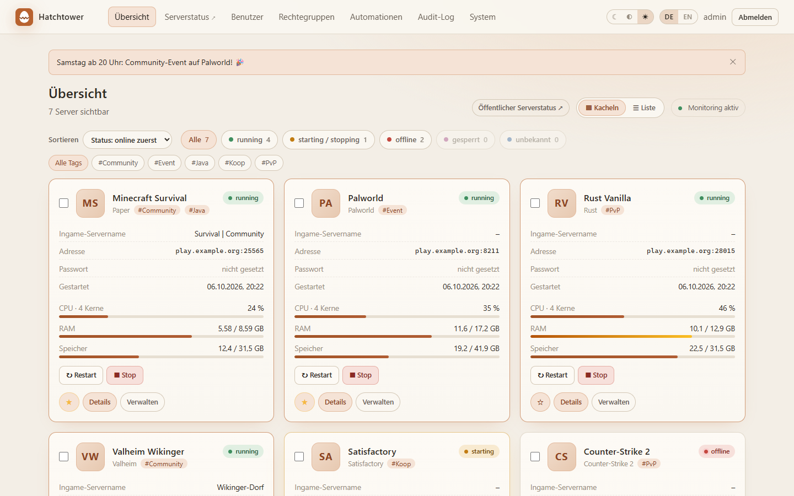
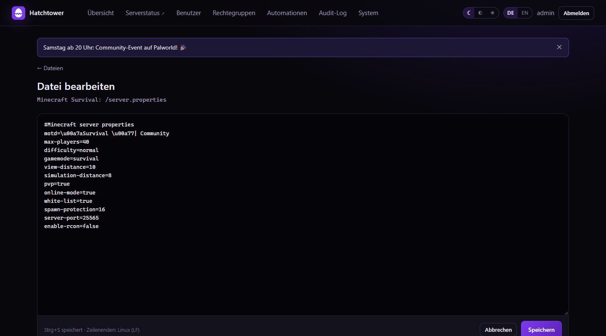
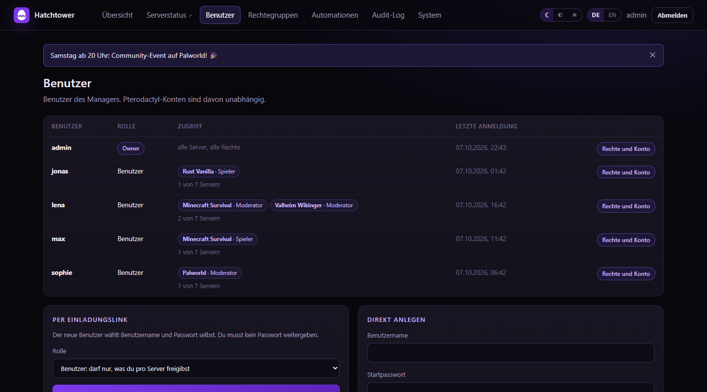
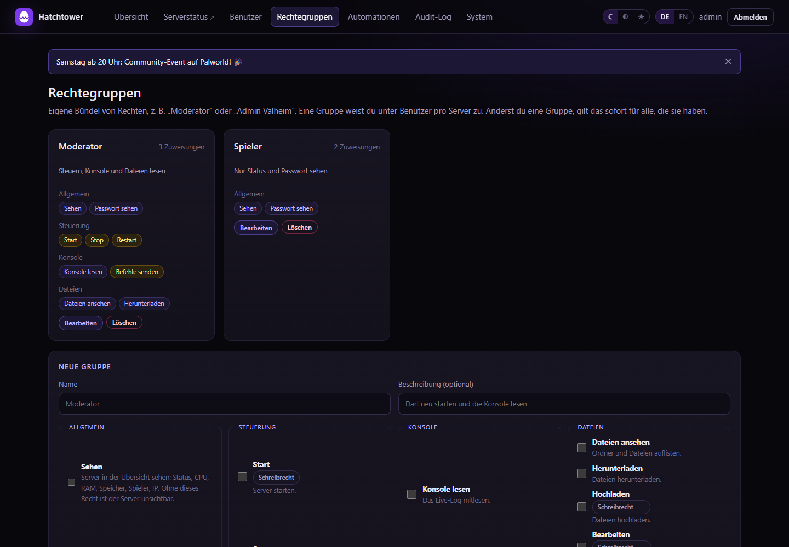
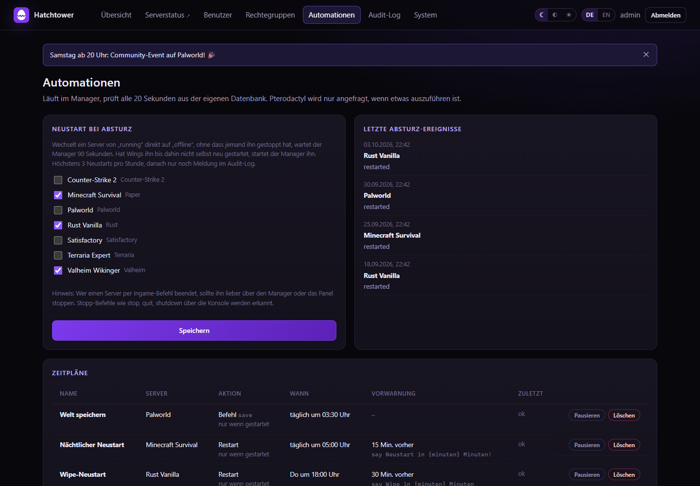
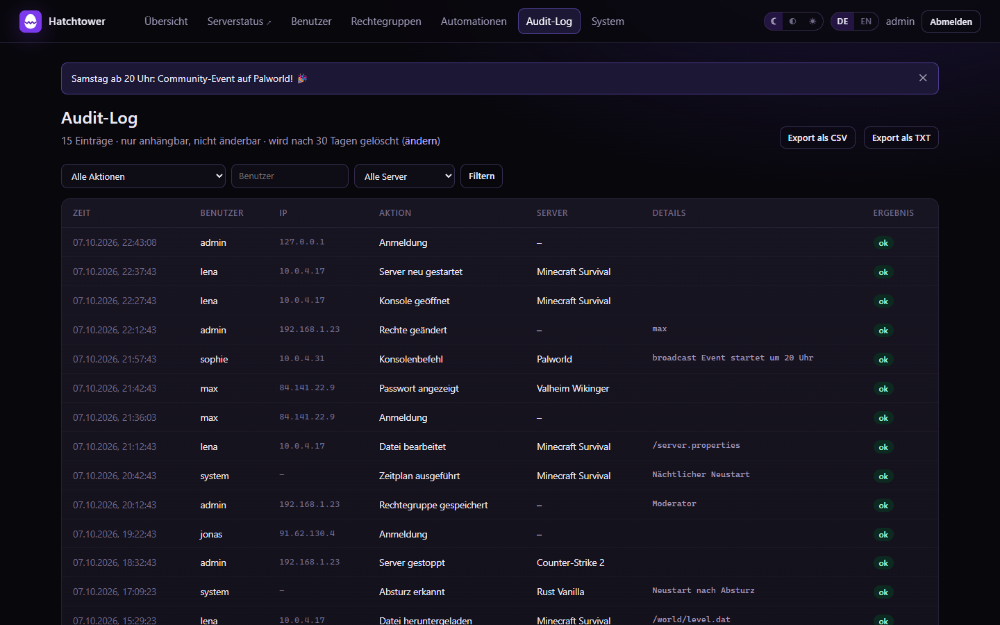
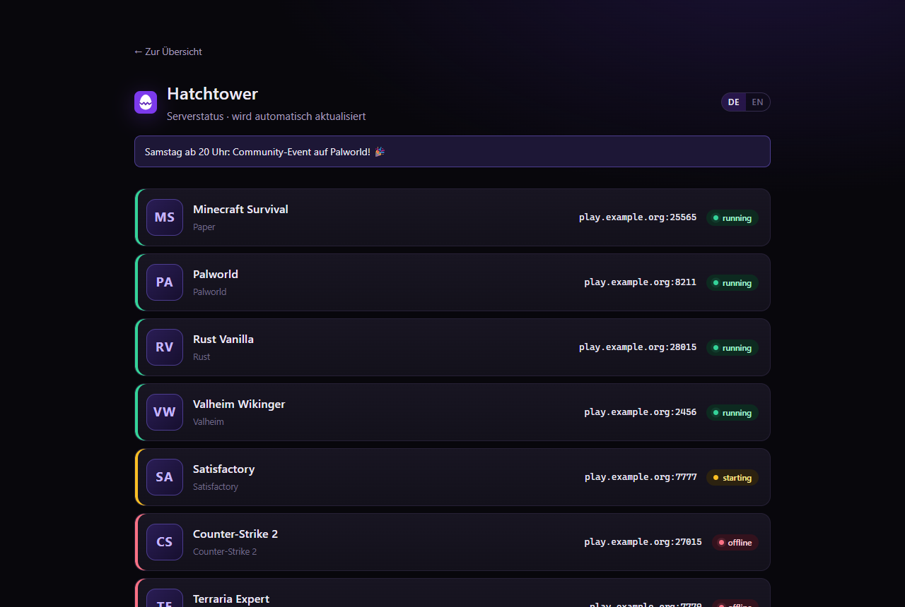
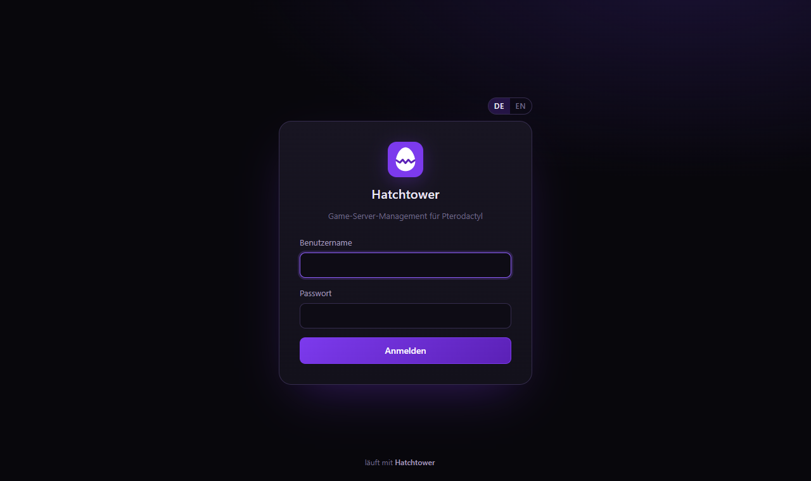

<div align="center">


# Hatchtower

**Die schöne, sichere Oberfläche für deine Pterodactyl-Game-Server.**

Server starten, Konsole mitlesen, Dateien bearbeiten, Rechte vergeben –
alles an einem Ort, für dich und dein Team.


</div>

---

## Was ist Hatchtower?

Du betreibst Game-Server mit **Pterodactyl** und möchtest Freunden, Moderatoren oder deiner
Community Zugriff geben – aber nicht gleich auf alles? Genau dafür gibt es Hatchtower.

Hatchtower ist ein **Begleiter** für dein Pterodactyl-Panel, **kein Ersatz**. Pterodactyl bleibt
die Stelle, an der deine Server wirklich laufen. Hatchtower legt sich darüber und bringt:

- 👥 **eigene Benutzer** mit genau den Rechten, die du ihnen gibst – pro Server
- 📈 **Live-Monitoring** mit Verlauf von CPU, RAM und Netzwerk
- ⏰ **Automationen** wie Neustart bei Absturz oder nächtliche Neustarts
- 📜 ein **Audit-Log**, das festhält, wer wann was getan hat
- 🔒 einen **Nur-Lesen-Modus**, mit dem garantiert nichts am Panel verändert wird

> **In 5 Minuten startklar:** Ein Befehl installiert alles, danach führt dich ein Assistent im
> Browser Schritt für Schritt durch die Einrichtung.

---

## Ein Blick hinein

### Alle Server auf einen Blick

Liste oder Kacheln, nach Status oder eigenen Tags filtern, Favoriten oben anheften – und
mehrere Server mit einem Klick gleichzeitig starten, stoppen oder neu starten.



### Jeder Server im Detail

Status, Adresse, Passwort, Online-Zeit der letzten 30 Tage, ein Verlauf über bis zu 72 Stunden
und die **Live-Konsole** – inklusive Suche und Download als Textdatei.


### Dateien direkt im Browser

Ansehen, hochladen, herunterladen (auch mehrere als ZIP), umbenennen, löschen und bearbeiten.
Beim Speichern bleibt die alte Fassung als `.bak` liegen – ein Klick, und sie ist wieder da.

<table>
  <tr>
    <td width="50%"></td>
    <td width="50%"></td>
  </tr>
</table>

### Benutzer und Rechte – so fein, wie du willst

Lege Gruppen wie „Moderator“ oder „Spieler“ an und weise sie pro Server zu. Wer nur sehen soll,
ob der Server läuft, sieht genau das – und sonst nichts. Neue Leute lädst du per
**Einladungslink** ein, ganz ohne Passwörter zu verschicken.

<table>
  <tr>
    <td width="50%"></td>
    <td width="50%"></td>
  </tr>
</table>

### Automationen

Stürzt ein Server ab, startet Hatchtower ihn auf Wunsch neu. Zeitpläne (wöchentlich oder
einmalig) starten, stoppen oder starten Server neu – mit Vorwarnung im Spiel, z. B.
„Neustart in 15 Minuten!“.



### Audit-Log

Jede Aktion wird festgehalten und lässt sich nicht nachträglich verändern. Filtern nach Aktion,
Benutzer und Server, Export als CSV oder TXT.



### Öffentliche Statusseite, Handy und Login

Eine Statusseite für deine Spieler (abschaltbar, ohne Passwörter und ohne Steuerung).
Auf dem Handy passt sich Hatchtower automatisch an.

<table>
  <tr>
    <td width="62%"><br><br>
                    </td>
    <td width="38%"></td>
  </tr>
</table>

<sub>Alle Screenshots stammen aus einer Demo-Instanz mit erfundenen Servern und Benutzern.</sub>

---

## Alle Funktionen

<details>
<summary><b>Komplette Liste aufklappen</b></summary>

**Server**
- Übersicht als Liste oder Kacheln, Statusfilter, Sortierung, Live-Werte (CPU bezogen aufs Limit, RAM, Speicher)
- Start, Stop, Restart, Kill (nur Owner), Konsolenbefehle
- Mehrere Server auf einmal starten, stoppen oder neu starten
- Live-Konsole und Verlauf von CPU, RAM und Netzwerk (live bis 72 Stunden)
- Favoriten und eigene Tags
- Verfügbarkeit: Online-Zeit und Abstürze der letzten 30 Tage
- Log-Archiv: Konsole laufender Server wird mitgeschrieben (1–90 Tage oder aus), durchsuchbar, Fehler farbig, Download als .txt

**Dateien**
- Ansehen, herunterladen (auch mehrere als ZIP), hochladen, bearbeiten, umbenennen, löschen
- Automatische `.bak`-Sicherung beim Bearbeiten, Wiederherstellen mit einem Klick

**Benutzer und Sicherheit**
- Eigene Benutzer und Rechte pro Server, selbst erstellte Rechtegruppen
- Einladungslinks statt Startpasswort
- Optional E-Mail: eigene Adresse pro Benutzer mit Bestätigung, „Passwort vergessen“, Einladungen per Mail
- Audit-Log, das sich nicht verändern lässt
- Read-Only-Modus: Hatchtower kann komplett nur lesend betrieben werden

**Automationen und Benachrichtigungen**
- Neustart bei Absturz
- Wöchentliche und einmalige Zeitpläne mit Vorwarnung
- Benachrichtigungen per Discord/Webhook und E-Mail: Absturz, Neustart, Neustart fehlgeschlagen,
  Speicher fast voll, RAM dauerhaft hoch, Zeitplan fehlgeschlagen

**Community**
- Öffentliche Statusseite (abschaltbar): Name, Spiel, Status und Adresse ausgewählter Server
- Ankündigungen oben auf jeder Seite, mit geplantem Beginn und Ende

**Aussehen und Sprache**
- 3 Themes (Dunkel, Mittel, Hell), pro Benutzer gespeichert
- Eigener Name und eigene Logos (z. B. die deiner Community)
- Deutsch und Englisch, automatisch nach Browsersprache oder per Umschalter
- Optimiert für Handy und Tablet

**Datenschutz und Umzug**
- Einstellbare Aufbewahrung (Audit-Log Standard 30 Tage)
- Impressum und Datenschutzerklärung mit Vorlagen, Datenauskunft pro Benutzer
- Datenumzug: alle Benutzer, Rechte, Logos und Einstellungen verschlüsselt exportieren und in einer neuen Instanz einspielen

</details>

---

## Was du brauchst

| | |
|---|---|
| **System** | Debian 12 oder 13 (gerne als Proxmox-LXC) |
| **Leistung** | 1 CPU-Kern, 512 MB RAM, 2 GB Speicher reichen |
| **Netzwerk** | Zugriff auf das Pterodactyl-Panel **und** die Wings-Server (Daemon-Port meist `8080`, SFTP meist `2022`) |
| **Pterodactyl** | Ein Admin-Zugang, um zwei API-Keys anzulegen. Getestet mit Panel 1.12 und Wings 1.12 |

---

## Installation

Wähle **einen** der drei Wege.

### 🅰 Auf Proxmox VE – ein Befehl

In der Shell des Proxmox-Hosts (als root):

```bash
bash -c "$(curl -fsSL https://raw.githubusercontent.com/skaot1910/hatchtower/main/proxmox/install.sh)"
```

Das Skript fragt Container-ID, Hostname, CPU, RAM, Speicher, Netzwerk und Port ab – jeweils mit
Vorschlag, **Enter** übernimmt ihn. Danach legt es einen Debian-Container an, lädt die neueste
Version, prüft die Prüfsumme und installiert alles.

<details>
<summary>Ohne Rückfragen installieren</summary>

```bash
HT_YES=1 HT_CTID=120 HT_IP=192.168.1.50/24 HT_GW=192.168.1.1 bash -c "$(curl -fsSL https://raw.githubusercontent.com/skaot1910/hatchtower/main/proxmox/install.sh)"
```

Alle Variablen stehen oben in `proxmox/install.sh`.
</details>

### 🅱 Auf einem vorhandenen Debian/Ubuntu-Server oder LXC

```bash
bash -c "$(curl -fsSL https://raw.githubusercontent.com/skaot1910/hatchtower/main/installer/get.sh)"
```

Optionen hängst du so an: `bash -c "$(curl …)" _ --allow "192.168.1.5"`

### 🅲 Aus einem Paket (ohne Internetzugriff auf GitHub)

Lade `hatchtower-<version>.tar.gz` unter **Releases** herunter, dann:

```bash
tar -xzf hatchtower-<version>.tar.gz
cd hatchtower-<version>
sudo bash installer/install.sh
```

**Optionen für den Installer**

| Option | Bedeutung |
|---|---|
| `--port 8000` | Port der Oberfläche |
| `--bind 0.0.0.0` | Adresse, auf der Hatchtower lauscht |
| `--allow "192.168.1.5,192.168.1.10"` | Port nur für diese IPs öffnen (eigene nftables-Tabelle, deine Firewall bleibt unberührt) |

<details>
<summary><b>Repository ist privat? So geht's mit GitHub-Token</b></summary>

Solange das Repository privat ist, braucht der Download einen Lese-Token.

**Token anlegen:** GitHub → **Settings → Developer settings → Personal access tokens →
Fine-grained tokens → Generate new token**. Als Repository nur `hatchtower` wählen, unter
*Permissions* bei **Contents** „Read-only“ einstellen. Der Token darf damit nur lesen und nur
dieses eine Repository.

**Installieren** (der Token wird nicht angezeigt und landet nicht im Verlauf):

```bash
read -rsp "GitHub-Token: " GITHUB_TOKEN && export GITHUB_TOKEN && echo
```

```bash
bash -c "$(curl -fsSL -H "Authorization: Bearer $GITHUB_TOKEN" -H "Accept: application/vnd.github.raw" https://api.github.com/repos/skaot1910/hatchtower/contents/proxmox/install.sh)"
```

Für Weg 🅱 stattdessen die Adresse
`https://api.github.com/repos/skaot1910/hatchtower/contents/installer/get.sh` verwenden.

Für spätere Updates hinterlegst du den Token auf dem Server mit `hatchtower github-token`.
Ist das Repository öffentlich, braucht es keinen Token mehr.
</details>

---

## Einrichtung im Browser

Am Ende der Installation siehst du die **Adresse** und einen **Einrichtungscode**. Öffne die
Adresse im Browser – ein Assistent führt dich durch fünf Schritte:

1. **Owner-Konto** anlegen (mit dem Einrichtungscode)
2. **Panel-Adresse** und **Application-API-Key** eintragen (nur Lese-Rechte nötig)
3. **Client-API-Key** eines eigenen Panel-Benutzers eintragen (mit *Allowed IP*)
4. **Wings-Server** prüfen – werden automatisch aus dem Panel gelesen, mehrere sind kein Problem
5. **Optionen** wählen: Modus, öffentliche Adresse für Spieler, Reverse-Proxy, Zeitzone

Fertig! 🎉

> 💡 Neue Installationen starten sicherheitshalber im Modus **Nur lesen**. Umstellen kannst du das
> jederzeit unter **System → Verbindung bearbeiten → Modus und Optionen**.
>
> API-Keys werden verschlüsselt gespeichert und nie wieder angezeigt.

**Eigener Look:** Unter **System → Erscheinungsbild** hinterlegst du den Namen und die Logos
deiner Community. Theme und Sprache wählt jeder Benutzer selbst oben rechts.

---

## Update

```bash
hatchtower update
```

Das war's. Hatchtower lädt die neueste Version, prüft die Prüfsumme, **sichert vorher die
Datenbank** und kehrt automatisch zur alten Version zurück, falls die neue nicht startet.
Benutzer, Rechte, Logos, Zeitpläne und Verlauf bleiben erhalten.

Unter **System** zeigt Hatchtower an, wenn eine neue Version bereitsteht. Installiert wird nie
automatisch – nur, wenn du es willst.

---

## Befehle auf dem Server

| Befehl | Was er tut |
|---|---|
| `hatchtower update` | Neueste Version installieren |
| `hatchtower update --check` | Nur nachsehen, ob es ein Update gibt |
| `hatchtower update <paket>` | Ein vorhandenes Paket installieren |
| `hatchtower selftest` | Verbindung zu Panel und Wings prüfen (nur lesend) |
| `hatchtower version` | Installierte Version anzeigen |
| `hatchtower reset-password` | Passwort eines Benutzers neu setzen und Konto entsperren |
| `hatchtower create-owner` | Owner-Konto auf der Konsole anlegen |
| `hatchtower setup-token` | Neuen Einrichtungscode erzeugen (nur solange noch kein Konto existiert) |
| `hatchtower github-token` | Lese-Token für ein privates Repository hinterlegen (`--remove` entfernt ihn) |
| `journalctl -u hatchtower -f` | Log des Dienstes live ansehen |

<details>
<summary>Wo liegt was?</summary>

| Pfad | Inhalt |
|---|---|
| `/opt/hatchtower` | Programm, Python-Umgebung, Installer, Werkzeuge |
| `/etc/hatchtower/hatchtower.env` | interne Schlüssel und Port (nicht weitergeben!) |
| `/var/lib/hatchtower/hatchtower.db` | Datenbank (SQLite) inkl. verschlüsselter API-Keys |
| `/var/backups/hatchtower/` | tägliches Backup um 03:30 (14 Tage) und Backups vor Updates |
| `/etc/hatchtower/github-token` | optional: Lese-Token für Updates aus einem privaten Repository |

</details>

---

## Sicherheit

- 🔑 Starke Passwörter (Argon2id), Sperre nach Fehlversuchen, Sitzungs-Timeouts
- 🛡️ CSRF-Schutz, strenge Content-Security-Policy, kein Einbetten in fremde Seiten
- 🚫 „Alles verboten, was nicht erlaubt ist“ – Rechte pro Benutzer und Server
- 👀 Der Nur-Lesen-Modus ist technisch erzwungen: Schreibende Anfragen erreichen Pterodactyl gar nicht erst
- 🌐 Für den Zugriff von außen bitte einen Reverse-Proxy mit HTTPS nutzen (z. B. Pangolin, Nginx, Traefik)

> ⚠️ Der Client-Key eines Panel-**Admins** darf technisch alles. Schütze ihn mit *Allowed IP*,
> Nur-Lesen-Modus und Audit-Log. Noch vorsichtiger: Lege einen eigenen Panel-Benutzer an und füge
> ihn nur als Subuser zu den gewünschten Servern hinzu.

---

## Für Entwickler

<details>
<summary>Werkzeuge und Aufbau</summary>

| Werkzeug | Zweck |
|---|---|
| `bash tools/release.sh` | Neue Version veröffentlichen: Tag, Paket aus Git, Prüfsumme, GitHub-Release (Text aus `CHANGELOG.md`) |
| `tools\build-release.ps1` | Testpaket aus dem Arbeitsordner bauen → `dist\hatchtower-<version>.tar.gz` |
| `tools\deploy.ps1 [-Target host]` | Paket bauen und per `hatchtower update` auf einen Server ausrollen |
| `tools/smoketest.sh` | Rauchtest auf dem Server, eigene Test-Datenbank, immer nur lesend |
| `tools/devserver.sh` | Test-Instanz auf Port 8001 für Oberflächentests (per SSH-Tunnel) |

**Neue Version veröffentlichen:** Version in `app/hatchtower/__init__.py` und `VERSION` erhöhen,
Abschnitt in `CHANGELOG.md` ergänzen, committen, dann in Git Bash `bash tools/release.sh`.

**Aufbau** (`app/hatchtower/`): `main.py` (Web), `ptero.py` (Pterodactyl-Adapter mit
Read-Only-Sperre), `wings.py` (Konsole), `monitor.py` (Abgleich, Verlauf), `automation.py`,
`permissions.py`, `security.py`, `setup.py` (Einrichtung), `themes.py`, `db.py` (Migrationen).

**Übersetzungen** liegen in `app/hatchtower/locales/<sprache>.json` (deutscher Text → Übersetzung).
Fehlt eine Übersetzung, erscheint der deutsche Text.

</details>

---

## Lizenz

Die Lizenz von Hatchtower selbst ist noch nicht festgelegt.

Alle Abhängigkeiten stehen unter freien, permissiven Lizenzen (MIT, BSD-3-Clause, Apache-2.0,
PSF-2.0, HPND/MIT-CMU, MPL-2.0 für certifi). Hatchtower enthält keine fremden Schriften, Icons,
Bilder oder JavaScript-Bibliotheken; Pterodactyl wird nur über die API angebunden. Die verwendeten
Bibliotheken und ihre Lizenzen findest du in der Oberfläche unter **Lizenzen** (Fußzeile) und als
vollständige Texte in `THIRD_PARTY_LICENSES.txt`, die bei jeder Installation neu erzeugt wird.

<div align="center">
<sub>Hatchtower ist ein unabhängiges Projekt und steht in keiner Verbindung zum Pterodactyl-Projekt.</sub>
</div>
